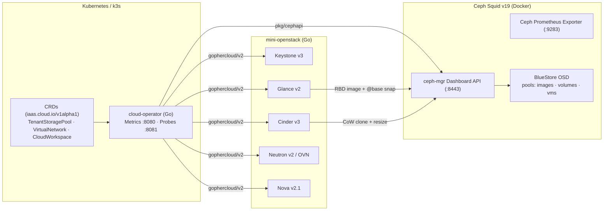

# openstack-ceph-operator

Go services, Kubernetes controllers, and configs for running a local cloud stack: Ceph Squid (v19) in Docker, a Go Ceph Dashboard REST client, an OpenStack API server compatible with `gophercloud/v2`, and a Kubernetes operator built with `controller-runtime`.

## Architecture



## Components

### Ceph (`ceph/`)

- `ceph/Dockerfile`, `ceph/docker-compose.yml`, `ceph/bootstrap.sh`: Ceph Squid (v19) container with `ceph-mon`, `ceph-mgr` (Dashboard REST API on `:8443`, Prometheus exporter on `:9283`), and a BlueStore OSD on a 6 GiB sparse loop file. Creates `images`, `volumes`, and `vms` RBD pools and CephX keyrings (`client.glance`, `client.cinder`, `client.nova`).
- `ceph/drills/openstack-rbd-drill.sh`: Script that checks cluster health, verifies `client.glance` cannot read `volumes`, creates a protected RBD snapshot, clones it into `volumes`, and runs `rados bench`.
- `ceph/ceph-client/`: Go client (`pkg/cephapi`) for the Ceph Dashboard REST API v1.0, `cephctl` CLI, and an in-memory `MockServer` for tests without Docker.
- `ceph/ops/`: Pool/keyring setup script and a 3-rack CRUSH map (`crush-rack-map.txt`).

### OpenStack (`openstack/mini-openstack/`)

- Go HTTP server implementing Keystone v3, Glance v2, Cinder v3, Neutron v2 (with OVN `binding:host_id`), and Nova v2.1 so `github.com/gophercloud/gophercloud/v2` talks to it directly.
- Glance image uploads create an RBD image in `images` and protect `@base`.
- Cinder boot volumes clone `images/glance-<id>@base` into `volumes` via Ceph copy-on-write and support online `os-extend` resize.
- Nova `os-migrateLive` with `block_migration=false` moves the VM host and updates Neutron OVN `binding:host_id` without copying disks.
- Falls back to `cephapi.MockServer` when `CEPH_API_URL` is empty.

### Kubernetes Operator (`openstack/cloud-operator/`)

Built with `sigs.k8s.io/controller-runtime`. Manages three CRDs under `iaas.cloud.io/v1alpha1`:

- `TenantStoragePool`: Creates and deletes Ceph RADOS pools through `pkg/cephapi` and writes Ceph health into status conditions.
- `VirtualNetwork`: Creates a Neutron network, subnet, optional router, and security group. Requeues periodically to detect and fix out-of-band security group rule changes (re-adds deleted rules, removes extra ingress rules).
- `CloudWorkspace`: Ensures the Glance image exists, clones a Cinder RBD boot volume (supports online resize when `spec.storageGiB` grows), creates a Neutron port, boots a Nova VM, and runs live migration when `spec.desiredHost` changes. Deletes in reverse order via finalizer: Nova -> Cinder -> Neutron.

### CI

- `.github/workflows/ci.yml`: Runs `go vet`, `go test -race`, `go build`, `golangci-lint`, and Trivy scan across all Go modules.

## Commands

Run tests offline (uses `cephapi.MockServer`) and build binaries:

```bash
make vet
make test-race
make build
```

Start Ceph in Docker and run all tests against it:

```bash
make ceph-up
./bin/cephctl health
make ceph-drill
CEPH_API_URL=https://localhost:8443 make test-race
```

Run `mini-openstack` against Ceph (or omit `CEPH_API_URL` to use the mock):

```bash
CEPH_API_URL=https://localhost:8443 ./bin/mini-openstack --addr :5000
```

## Deploy the operator to cluster

### 1. Build and import the image

```bash
docker build -f openstack/cloud-operator/Dockerfile -t ghcr.io/omerharuncetin/cloud-operator:latest .
```

Copy the image into `k3s` containerd:

```bash
docker save ghcr.io/omerharuncetin/cloud-operator:latest | ssh <user>@<k3s-host> "sudo k3s ctr images import -"
```

### 2. Apply CRDs, RBAC, and deployments

```bash
kubectl apply -f openstack/cloud-operator/config/crd/
kubectl apply -f openstack/cloud-operator/config/deploy/rbac.yaml
kubectl apply -f openstack/cloud-operator/config/deploy/operator.yaml
```

Update `Secret/cloud-operator-credentials` in `cloud-system`:

- To use your Ceph Squid container, set `CEPH_API_URL` to its reachable URL (for example `https://<ceph-host-ip>:8443`).
- To run standalone without Ceph, set `CEPH_API_URL` to `""` on `mini-openstack` so it uses the in-memory mock.

Check pod rollout:

```bash
kubectl -n cloud-system rollout status deploy/mini-openstack
kubectl -n cloud-system rollout status deploy/cloud-operator
```

### 3. Create sample resources

```bash
kubectl apply -f openstack/cloud-operator/config/samples/full-stack-tenant.yaml
kubectl get tsp,vnet,cws
```

Test online RBD resize and live migration:

```bash
kubectl patch cws web-frontend-01 --type=merge \
  -p '{"spec":{"storageGiB":4,"desiredHost":"compute-02"}}'
kubectl get cws web-frontend-01
```

Check Prometheus metrics:

```bash
kubectl -n cloud-system port-forward svc/cloud-operator-metrics 8080:8080
curl -s http://localhost:8080/metrics | grep cloud_operator_
```

### 4. Cleanup

Delete everything and verify reverse-order finalizer cleanup:

```bash
kubectl delete -f openstack/cloud-operator/config/samples/full-stack-tenant.yaml
kubectl -n cloud-system logs -f deploy/cloud-operator
```


## Repo Layout

```text
.
├── ceph/
│   ├── Dockerfile               # Ceph Squid v19 image with bootstrap and drills
│   ├── docker-compose.yml       # Ceph Docker Compose file
│   ├── bootstrap.sh             # MON, MGR, BlueStore OSD, pools, and CephX setup
│   ├── drills/                  # CephX and RBD copy-on-write clone drill
│   ├── ceph-client/             # Go Ceph Dashboard REST client (pkg/cephapi) + cephctl
│   ├── ops/                     # CephX keyring script and 3-rack CRUSH map
│   └── notes.md                 # Ceph study notes
├── openstack/
│   ├── mini-openstack/          # Go OpenStack API server backed by Ceph RBD
│   └── cloud-operator/          # Go Kubernetes operator (CRDs, controllers, k3s manifests)
├── .github/workflows/ci.yml     # CI pipeline
├── .golangci.yml                # Linter settings
├── go.work                      # Go workspace
└── Makefile                     # Common build, test, and run targets
```
